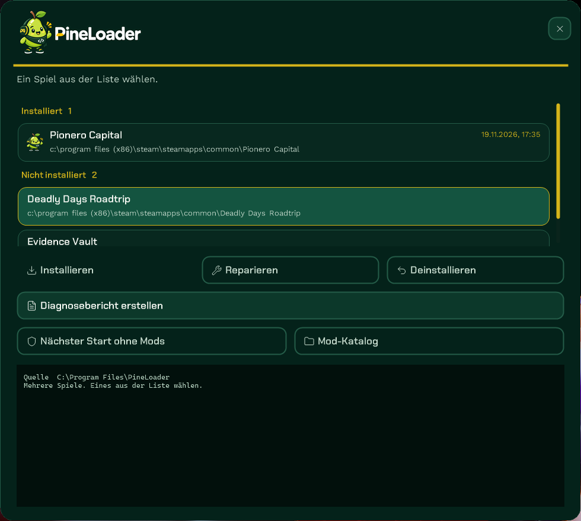
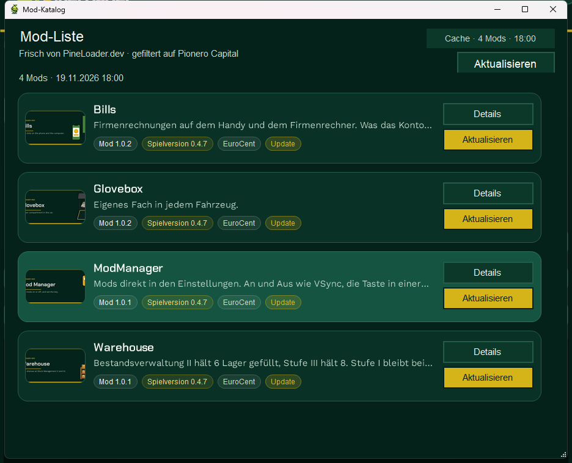
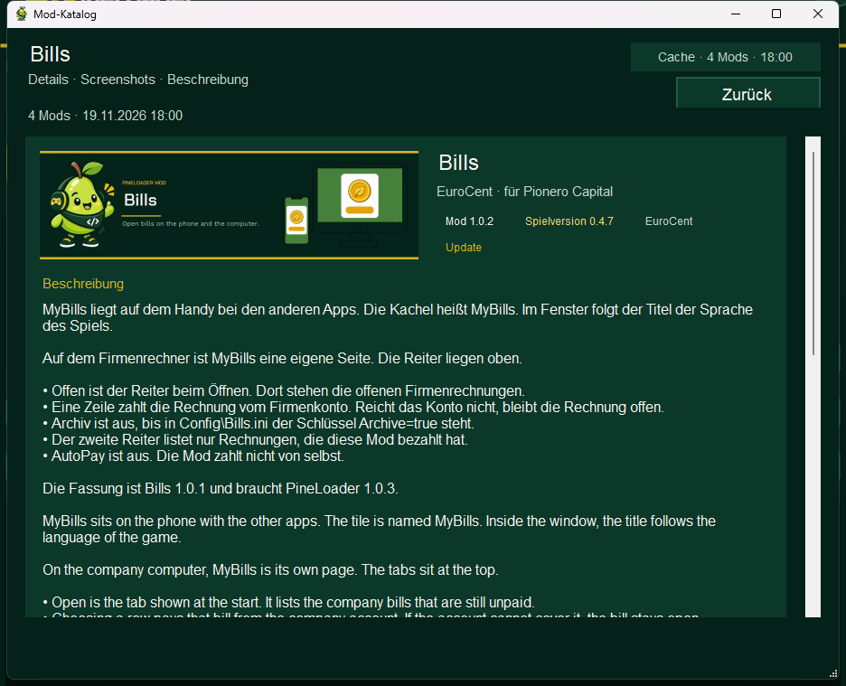
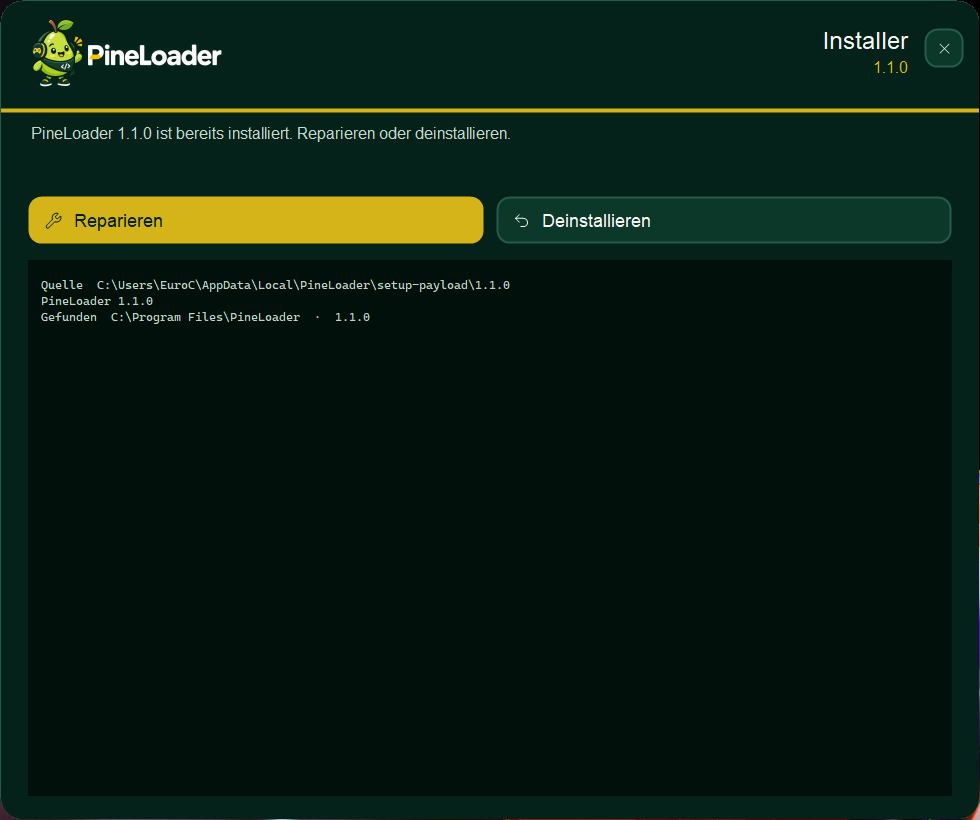

<p align="center">
  
</p>

<p align="center">
  <a href="https://github.com/EuroCent82/PineLoader">GitHub</a>
  &nbsp;·&nbsp;
  <a href="#features">Features</a>
  &nbsp;·&nbsp;
  <a href="#install">Install</a>
  &nbsp;·&nbsp;
  <a href="#folders">Folders</a>
  &nbsp;·&nbsp;
  <a href="#changelog">Changelog</a>
  &nbsp;·&nbsp;
  <a href="#author">Author</a>
</p>

<p align="center">
  A Windows mod loader for games built with Unreal Engine 5.8+.<br>
  Starts before the game and loads compatible mods without modifying original game files.
</p>

<p align="center">
  <a href="https://github.com/EuroCent82/PineLoader"></a>
  <a href="LICENSE"></a>
  
  <a href="https://pineloader.dev"></a>
</p>

<p align="center">
  <a href="https://github.com/EuroCent82/PineLoader/releases/tag/v1.1.0-alpha"></a>
</p>

The guide and documentation are on [PineLoader.dev](https://pineloader.dev).

## Current release

**Version 1.1.0-alpha** is an Alpha prerelease for testing. The download includes the PineLoader application and its Java shim. Mods are distributed and installed separately.

## Features

- **Unreal Engine Detection**: Automatically discovers games using Unreal Engine 5.8+ (such as *Pionero Capital*) across all Steam library folders.
- **Seamless Steam Start**: Launches automatically before the game when pressing **Play** in Steam — no custom Steam launch parameters required.
- **Mod Isolation**: Keeps each mod isolated. A faulty or crashing mod does not prevent the game itself from starting.
- **Game Hub & Diagnostics**: Built-in Hub offering real-time status of loaded mods, Java agents, network ports, filtered Windows application event logs, and safe-mode controls.
- **Mod List & Catalog**: Browse installed mods, inspect descriptions and screenshots, toggle mods on/off, or uninstall them cleanly.
- **Drag-and-Drop Installation**: Drop mod `.zip` archives directly into the Hub or Mod List for instant installation with step-by-step progress tracking.

<p align="center">
  
</p>

<p align="center">
  
</p>

<p align="center">
  
</p>

## Install

### Option A: Desktop Installer (Recommended)
1. Download `PineLoader-Setup-1.1.0-alpha.exe` from the [1.1.0-alpha release](https://github.com/EuroCent82/PineLoader/releases/tag/v1.1.0-alpha).
2. Run the setup and follow the instructions to locate your game installation.

<p align="center">
  
</p>

### Option B: Manual ZIP Installation
1. Close the game.
2. Download `PineLoader-1.1.0-alpha-win-x64.zip` from the [1.1.0-alpha release](https://github.com/EuroCent82/PineLoader/releases/tag/v1.1.0-alpha).
3. Extract the `PineLoader` folder beside the game folder.
4. Launch `PineLoader.exe` once and complete setup.
5. Leave Steam launch options empty. Start the game normally via **Play** in Steam.

## Folders

```text
PineLoader/
  PineLoader.exe
  shim/PineJava.exe
  Mods/<ModName>/<ModName>.dll
  Config/<ModName>.ini
  Cache/
  Logs/
```

Install individual mods into `PineLoader\Mods\<ModName>`. Each mod comes with its own instructions. Back up your save files before installing community mods.

## Changelog

See [Changelog.txt](Changelog.txt) for detailed version history and [instructions.txt](instructions.txt) for installation notes.

## Author and license

EuroCent82 · [PineLoader.dev](https://pineloader.dev)

Licensed under the Apache License, Version 2.0. See [LICENSE](LICENSE).
